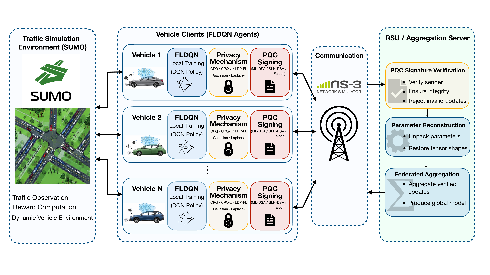

# Communication-Efficient Private Federated Reinforcement Learning with Post-Quantum Authentication for Vehicular Networks

Code for the paper of the same title. Vehicles learn a routing policy with federated deep Q-learning in
SUMO and exchange their models with a road-side unit (RSU). The model updates are protected with
one-bit private quantization (CPQ, CPQ-λ, LDP-FL) or with Gaussian / Laplace noise, signed with
post-quantum signatures (ML-DSA-44, Falcon-512, SLH-DSA-SHA2-128f) and, in the mobility-coupled
experiments, carried over a packet-level IEEE 802.11p channel simulated in ns-3.



## Repository layout

| Path | Content |
|---|---|
| `run_shared.py` | One federated run: all learning vehicles in one SUMO world, rounds of local DQN training and aggregation |
| `shared_env.py`, `shared_train.py`, `dqnenv.py` | SUMO environment, episodes, evaluation |
| `dqnagent.py`, `dqn.py` | DQN agent and network |
| `onebit.py` | One-bit quantizers: CPQ, CPQ-λ and LDP-FL (encoding and server decoding) |
| `cpq_pairing.py`, `group_setup.py` | Server-hidden per-coordinate pairing of CPQ and the ML-KEM group-key setup |
| `additive.py` | Gaussian and Laplace mechanisms |
| `comm.py`, `ns3_link.py` | Model exchange over ns-3 (downlink / uplink drives, RSU scheduling) |
| `pqc/`, `pqc_oracle.py`, `oracle_transport.py` | Post-quantum signatures (liboqs) |
| `server.py`, `server_onebit.py`, `run_server.py`, `run_client.py` | Aggregation strategies and the per-vehicle client |
| `mse_log.py`, `attack_log.py` | Optional logging: aggregation MSE, data for the origin inference attack |
| `attack/` | Vehicle-origin inference attack |
| `ns3_integration/` | ns-3 program (`fl-sim.cc`): 802.11p channel, RSU, SR-ARQ transport |
| `configs/base.yaml` | Configuration shared by all experiments |
| `tools/run_experiment.py` | Launches the runs of one experiment (configs, seeds, parallel runs) |
| `tools/analyze_experiment.py` | Result tables of one experiment from its run folders |
| `Net/`, `Add/`, `dqn.sumocfg` | SUMO road network, detectors and configuration |
| `tests/` | Checks of the mechanisms, pairing, group setup, DQN and environment |

## Requirements

Tested on Ubuntu 20.04 with:

- Python 3.10
- SUMO 1.26.0 (`eclipse-sumo` from pip, or a system install with `SUMO_HOME` set)
- liboqs 0.15.0 and liboqs-python 0.14.1
- ns-3.46 (only for the experiments with communication), see `ns3_integration/README_NS3.md`

```bash
conda create -n cpq-frl python=3.10
conda activate cpq-frl
pip install -r requirements.txt
export SUMO_HOME="$(python -c 'import sumo, os; print(os.path.dirname(sumo.__file__))')"
```

The attack analysis and the figures use a separate environment (`requirements-analysis.txt`).

## Running the experiments

Each experiment is a set of runs; every run is `configs/base.yaml` plus the changes listed for it in
`tools/run_experiment.py` (method, privacy budget, seed, ns-3 on/off, ...).

```bash
python tools/run_experiment.py E1 --dry-run     # list the runs
python tools/run_experiment.py E1               # run them (3 in parallel by default)
python tools/analyze_experiment.py experiments/final/E1_privacy_utility
```

| Experiment | Paper |
|---|---|
| `E1` | Privacy–utility under ideal communication |
| `E2` | Mobility-constrained federated learning over ns-3 with ML-DSA-44 |
| `E3` | Post-quantum signature schemes |
| `A1` | CPQ-λ ablation |
| `A2`, `A3` | Number of learning vehicles, traffic density |
| `ATKN` | Vehicle-origin inference attack |

A single run can also be started directly:

```bash
FL_SEED=1 FL_OUT_DIR=results/test python run_shared.py --config configs/base.yaml
```

## Tests

```bash
for t in tests/check_*.py; do python "$t" || echo "FAILED: $t"; done
```

## Results

The processed results used in the paper and the raw run outputs are archived on Zenodo:
DOI to be added.

## License

MIT, see `LICENSE`.
