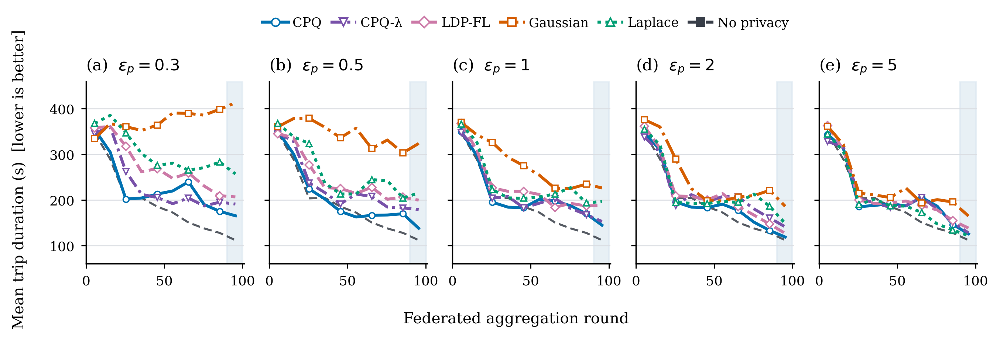
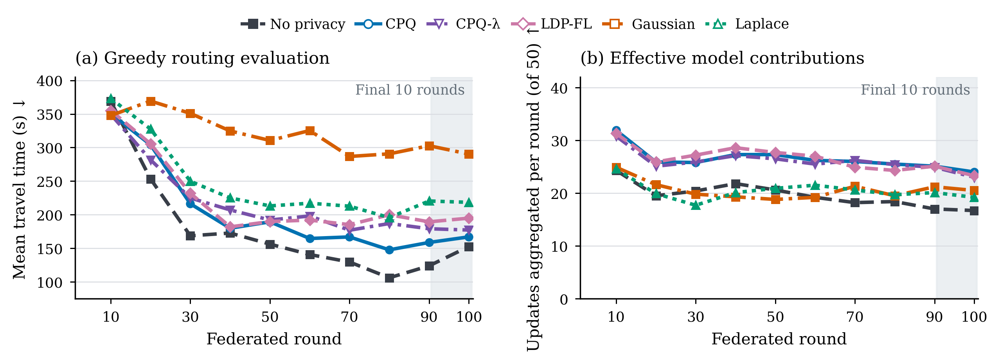

# Communication-Efficient Private Federated Reinforcement Learning with Post-Quantum Authentication for Vehicular Networks

[](https://doi.org/10.5281/zenodo.23693204)

Code for the paper of the same title. Vehicles learn a routing policy with federated deep Q-learning in
SUMO and exchange their models with a road-side unit (RSU). The model updates are protected with
one-bit private quantization (CPQ, CPQ-λ, LDP-FL) or with Gaussian / Laplace noise, signed with
post-quantum signatures (ML-DSA-44, Falcon-512, SLH-DSA-SHA2-128f) and, in the mobility-coupled
experiments, carried over a packet-level IEEE 802.11p channel simulated in ns-3.


## Repository layout

```
cpq-vehicular-frl/
├── run_shared.py        one federated run (entry point)
├── configs/base.yaml    configuration shared by all experiments
├── frl/                 Python package
│   ├── learning/        DQN network and agent
│   ├── env/             SUMO environment, episodes, evaluation
│   ├── privacy/         CPQ, CPQ-λ, LDP-FL (onebit.py), pairing and group-key setup, Gaussian / Laplace
│   ├── federated/       aggregation strategies and the vehicle client
│   ├── comm/            model exchange over ns-3 and PQC signatures
│   └── monitoring/      optional logs (aggregation MSE, attack data)
├── sumo/                road network, detectors, routes          (see sumo/README.md)
├── ns3/                 ns-3 program: 802.11p channel, RSU, transport (see ns3/README.md)
├── attack/              vehicle-origin inference attack
├── tools/               run_experiment.py, analyze_experiment.py
├── figures/             scripts for the figures of the paper
└── tests/
```

All commands are run from the repository root.

## Installation

Tested on Ubuntu 20.04 with Python 3.10, SUMO 1.26.0, liboqs 0.15.0 and ns-3.46.

```bash
git clone https://github.com/solidlabnetwork/cpq-vehicular-frl.git
cd cpq-vehicular-frl
conda create -n cpq-frl python=3.10
conda activate cpq-frl
pip install -r requirements.txt
export SUMO_HOME="$(python -c 'import sumo, os; print(os.path.dirname(sumo.__file__))')"
```

liboqs-python needs the liboqs C library:

```bash
git clone --branch 0.15.0 --depth 1 https://github.com/open-quantum-safe/liboqs
cmake -S liboqs -B liboqs/build -DBUILD_SHARED_LIBS=ON -DCMAKE_INSTALL_PREFIX=$HOME/oqs_install
cmake --build liboqs/build --parallel 8 && cmake --install liboqs/build
export OQS_INSTALL_PATH=$HOME/oqs_install
export LD_LIBRARY_PATH=$HOME/oqs_install/lib:$LD_LIBRARY_PATH
```

ns-3 is only needed for the experiments over 802.11p: see [ns3/README.md](ns3/README.md). The attack
analysis and the figures use `requirements-analysis.txt` (a separate environment is fine).

Check the installation with the tests:

```bash
for t in tests/check_*.py; do python "$t" || echo "FAILED: $t"; done
```

## Reproducing the experiments

Every run is `configs/base.yaml` plus the changes listed for it in `tools/run_experiment.py`. The launcher
writes configs, logs and outputs to `experiments/final/<output folder>/`, runs 3 runs in parallel and skips
finished runs, so it can be restarted at any time.

```bash
python tools/run_experiment.py E1 --dry-run        # list the runs
python tools/run_experiment.py E1                  # run them
python tools/analyze_experiment.py experiments/final/E1_privacy_utility   # summary tables
```

| Experiment | Output folder | Reproduces | Runs | Time per run |
|---|---|---|---|---|
| `E1` | `E1_privacy_utility` | Fig. 2, Table 2, Figs. J.1, J.3, J.4: all mechanisms at ε = 0.3, 0.5, 1, 2, 5 | 130 | 1.5 h |
| `LAMBDA` | `cpq_lambda_ablation` | Table 3, Fig. J.2: CPQ-λ ablation at ε = 1, with aggregation MSE | 60 | 1.5 h |
| `POPULATION` | `population_size` | Table J.1: 10 and 25 learning vehicles | 30 | 0.7 h |
| `E2` | `E2_v2i_communication` | Figs. 3, 4, Table 5: 802.11p with ML-DSA-44 at ε = 1 | 30 | 3 h |
| `E3` | `E3_signature_schemes` | Table 4, Figs. I.1, K.1: signature schemes (one seed, 30 rounds) | 6 | 0.8 h |
| `ATTACK` | `origin_attack` | Fig. 5: data for the origin inference attack (10 origins, 802.11p) | 15 | 4 h |

The attack itself runs on the logged data: `python -m attack.run --stage all --config attack/config.yaml`.

A single run can be started directly:

```bash
FL_SEED=1 FL_OUT_DIR=results/test python run_shared.py --config configs/base.yaml
```

## Tables and figures

`tools/paper_results.py` computes the tables of the paper and the data of every figure from the run folders in
`experiments/final/` (your own runs or the archived ones below); the figure scripts then plot them:

```bash
python tools/paper_results.py                                    # results/paper/tables.md, figure_data.json
bash figures/make_all.sh --data results/paper/figure_data.json   # figures/output/*.pdf, *.png
python tools/bench_signatures.py                                 # Table H.1 (timings depend on the machine)
```

Without `--data`, the figure scripts plot the numbers of the paper, which are embedded in them:

| Script | Figures |
|---|---|
| `fig2_fig4_learning.py` | 2, 4 |
| `fig3_v2i_communication.py` | 3 |
| `fig5_origin_inference.py` | 5 |
| `appendix_e1_seeds.py` | J.1, J.3, J.4 |
| `appendix_cpq_lambda_paired.py` | J.2 |
| `appendix_e3_signatures.py` | I.1, K.1 |

## Main results

Mean travel time (s) in rounds 91–100 under ideal communication, mean ± standard deviation over 5 seeds
(no privacy: 111.8 ± 36.7):

| Mechanism | ε = 0.3 | ε = 0.5 | ε = 1 | ε = 2 | ε = 5 |
|---|---|---|---|---|---|
| CPQ | **165.3 ± 21.4** | **137.9 ± 59.7** | **144.7 ± 26.5** | **118.6 ± 23.1** | 125.7 ± 24.5 |
| CPQ-λ (λ = 0.75) | 191.0 ± 36.4 | 178.8 ± 42.7 | 152.8 ± 17.5 | 141.1 ± 41.7 | 127.8 ± 11.9 |
| LDP-FL | 206.6 ± 33.2 | 199.5 ± 21.8 | 187.7 ± 25.3 | 126.7 ± 45.5 | 138.3 ± 38.3 |
| Gaussian | 412.8 ± 30.5 | 323.8 ± 56.4 | 226.2 ± 41.8 | 186.1 ± 30.9 | 164.6 ± 43.1 |
| Laplace | 257.1 ± 19.7 | 215.1 ± 19.6 | 196.9 ± 37.8 | 148.4 ± 15.9 | **121.5 ± 20.0** |



Empirical aggregation MSE of CPQ-λ at ε = 1 (×10⁻⁵): 3.717 for LDP-FL (λ = 0), 2.825 at λ = 0.5,
1.708 at λ = 0.75 and 0.145 for CPQ (λ = 1).

Over 802.11p with ML-DSA-44 at ε = 1 (5 seeds):

| Method | Travel time (s) | Arrival (%) | Uplink delivered (%) | Verified updates per round |
|---|---|---|---|---|
| No privacy | 152.6 | 80.4 | 75.7 | 19.6 |
| CPQ | 167.0 | 79.8 | 99.4 | 26.5 |
| CPQ-λ (λ = 0.75) | 177.2 | 75.8 | 99.5 | 26.1 |
| LDP-FL | 194.9 | 72.8 | 99.4 | 26.5 |
| Gaussian | 290.3 | 51.8 | 74.0 | 20.6 |
| Laplace | 218.4 | 66.4 | 75.9 | 20.4 |



One-bit updates reduce the signed uplink from 113.76 KB to 8.65 KB (ML-DSA-44); with Falcon-512 the CPQ
uplink is 6.89 KB and with SLH-DSA-SHA2-128f 23.34 KB. At ε = 0.3, a vehicle-origin inference attack
trained on shadow runs reaches 30% accuracy against CPQ and 22% against LDP-FL after 100 rounds, versus
91% without privacy (chance: 10%).

## Results archive (Zenodo)

The outputs of all runs behind the paper are archived on Zenodo:
[10.5281/zenodo.23693204](https://doi.org/10.5281/zenodo.23693204). There is one zip file per experiment, named
after the output folders above; each unpacks into `experiments/final/<folder>/`. To reproduce the tables and
figures without running the simulations:

```bash
unzip E1_privacy_utility.zip                     # in the repository root; likewise the other zip files
python tools/paper_results.py
bash figures/make_all.sh --data results/paper/figure_data.json
```

Each run folder holds its configuration (`config.yaml`), the evaluation of the global model per round
(`global_eval.csv`), the baselines, and, for the 802.11p experiments, every transfer attempt (`comm.csv`) and the
participation per round (`participation.csv`). The attack can be recomputed from `origin_attack.zip` with
`python -m attack.run --stage all --config attack/config.yaml`.

## License

MIT, see [LICENSE](LICENSE).
